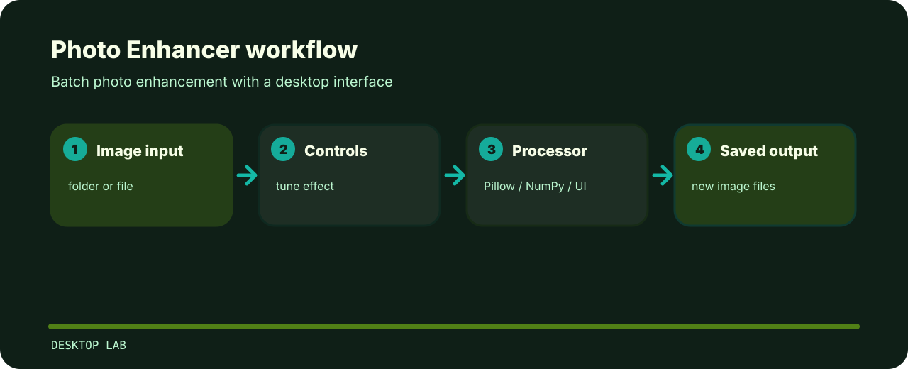

# Photo Enhancer


A desktop batch enhancer for JPG, JPEG, and PNG files. It keeps originals untouched and writes processed copies with an `enhanced_` prefix.

## Processing path



| Before | After |
| --- | --- |
|  |  |


## Local run

```bash
git clone https://github.com/mertefekurt/PhotoEnchancer.git
cd PhotoEnchancer
python -m pip install -r requirements.txt
python src/image_processor_gui.py
```

## Notes

- Originals stay untouched.
- Processed files are written with a predictable prefix.
- The interface is intentionally small enough for quick batch work.
