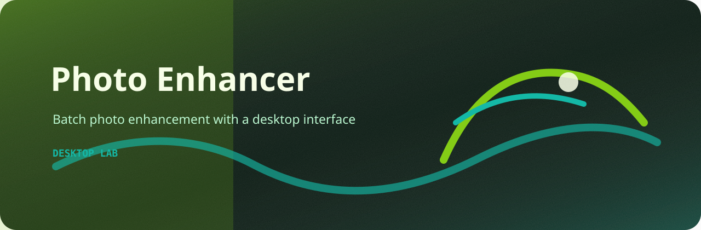

# Photo Enhancer

A desktop batch enhancer for photos.



## What it does

- loads a folder of JPG/JPEG/PNG images
- applies brightness, contrast, and saturation adjustments
- keeps the original files untouched
- writes enhanced copies with an `enhanced_` prefix

## Before / after

| Before | After |
| --- | --- |
|  |  |


## Run

```bash
git clone https://github.com/mertefekurt/PhotoEnchancer.git
cd PhotoEnchancer
python -m pip install -r requirements.txt
python src/image_processor_gui.py
```
